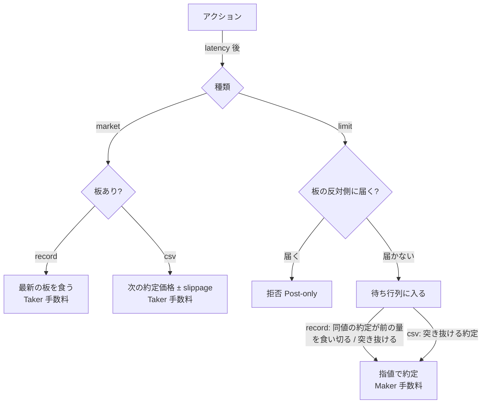

# backtest: 戦略を過去の約定と記録した板で検証する

## 結論

- `gmocoin backtest` は戦略ファイル (TypeScript) を読み、過去の約定 (と板) を時刻順に流して、仮想の口座で損益を出す。注文は出さず、API キーは要らない
- 入力は 2 種類から選ぶ。`--source csv` は GMO の日次約定 CSV (2021-01-01 から、自動で取得してキャッシュ)、`--source record` は `gmocoin record` の出力 (板 + 約定)
- 指値は Post-only (GMO の `SOK`) として扱う。record では板の待ち行列を再現して約定させ、csv では価格を突き抜けた約定が出たときだけ約定させる
- 手数料は既定で GMO コインの現物の Maker -0.01% (受け取り) / Taker 0.05% を JPY で計上する。`--maker-fee-bps` / `--taker-fee-bps` で変えられる (Coincheck なら両方 0)。成行は record では板を食って約定価格がずれ、csv では次の約定価格に `--slippage-bps` を不利な側に足す
- `--split` で学習用と検証用の期間を分け、それぞれ新しい口座と新しい戦略で回す。検証用の期間で計画の成功基準 (手数料込みの損益 > 0、最大ドローダウン ≤ 20%) を満たすかを `pass` で出す
- 結果は stdout に JSON、CSV の取得 (1 日 1 行) と警告は stderr

## 使い方

```bash
gmocoin backtest --strategy strategies/sma-cross.ts --from 2021-01-01 --to 2026-10-01 --split 2025-01-01
gmocoin backtest --strategy strategies/sma-cross.ts --source record --data /srv/gmocoin --from 2026-10-13 --to 2026-10-14
```

- `--strategy <file>` (必須): 戦略ファイル。default export が戦略を返す関数
- `--from <time>` / `--to <time>` (必須): 期間。`2025-01-01` (UTC の 0 時) か ISO 8601。`from` を含み `to` を含まない
- `--split <time>`: 学習用 `[from, split)` と検証用 `[split, to)` に分ける。無ければ全体を 1 期間 (`all`) で回す
- `--source <csv|record>` (既定 `csv`)
- `--data <dir>` (既定 `./data`): csv はキャッシュを `<data>/csv/<symbol>/` に置き、record は `<data>/orderbooks/<symbol>/` と `<data>/trades/<symbol>/` を読む (`gmocoin record --out` と同じディレクトリ)
- `--symbol <symbol>` (既定 `BTC`): 今は `BTC` だけを受け付ける。数量と値段の刻みを BTC 現物の値で固定しているため
- `--capital <jpy>` (既定 `10000`)
- `--latency-ms <ms>` (既定 `0`): 注文と取消が効くまでの遅れ
- `--slippage-bps <bps>` (既定 `0`): csv の成行の約定価格を不利な側にずらす量。record では使わない (板を食うぶんがスリッページ)
- `--maker-fee-bps <bps>` (既定 `-1`) / `--taker-fee-bps <bps>` (既定 `5`): 指値 / 成行の約定代金に掛ける手数料。マイナスは受け取り。期末の評価で引く手数料も `--taker-fee-bps` に従う
- `--warmup-days <days>` (既定 `0`): 各期間の前のこの日数分の約定 CSV を戦略に流し、履歴を貯めさせる。その間に戦略が返した注文は捨て (戦略に onFill / onReject は届かない)、評価額・イベント数にも数えない。最後の約定価格だけは期間に持ち越し、期間の最初の `ctx.lastPrice` になる。毎回 `ctx` の現金・保有量・`pending` から判断し直す戦略向けで、「注文を出した」ことを自分の変数で覚えて 2 度目を出さない戦略は、温めの間に覚えてしまい期間に 1 度も注文しない。record には過去分が無いので、`--source record` でも温めは約定 CSV から取る。trend-ensemble は 56 日の SMA と 20 日のボラティリティを使うので、温めないと期間の最初の数十日は少ない履歴で売買する
- CSV の取得元は環境変数 `GMOCOIN_TRADES_CSV_URL` で上書きできる (既定 `https://api.coin.z.com/data/trades`)

## 入力の形 (2026-10-14 に観測)

### 日次約定 CSV

- URL は `<base>/<symbol>/<YYYY>/<MM>/<YYYYMMDD>_<symbol>.csv.gz`。中身は `symbol,side,size,price,timestamp` のヘッダーと 1 約定 1 行
- 時刻は UTC でタイムゾーンの表記が無い。`20261012_BTC.csv.gz` の最後の行 `BTC,BUY,0.0003,13169883.000,2026-10-12 20:59:56.936` は REST `/public/v1/trades` の `2026-10-12T20:59:56.936Z` の約定と一致した
- 1 ファイルは日本時間 6:00 で区切った 1 日で、`YYYYMMDD` のファイルは UTC の前日 21:00 から当日 21:00 まで
- 当日分はまだ無い。2026-10-14 01:50 JST に `20261013` は 403 だった
- 数量は小数 4 桁に丸められ、`0.0000` の行がある。そのまま読み、数量 0 の約定として扱う
- `side` は REST が BUY と SELL の対で返す約定を 1 行にしたもの。taker 側として読む (記録の `TAKER_ONLY` と同じ意味)

### record の出力

- `docs/design/record.md` のとおり。1 行は `{"recv_at":...,"msg":<受信した JSON>}`
- 時刻は `msg.timestamp` (取引所の時刻) を使い、`recv_at` は使わない
- ファイルは名前順に、gzip のメンバーを順に展開して読む。末尾が壊れていたらそのファイルはそこまでにして、stderr に 1 行出して次のファイルへ進む
- 読むファイルは名前の日付が `from` の前日から `to` の直前の翌日までのもの (受信時刻で日付を切るので、日付の変わり目の数 ms ぶん隣のファイルに入る)。期間外の行は読み飛ばす
- 板と約定は channel ごとに時刻順に並んでいる前提で、2 本を時刻で併合する。同じ時刻なら約定を先に流す

## 取得とキャッシュ (csv)

- 期間に要るファイル (`from` を含むファイルから `to` の直前を含むファイルまで。ファイル `D` は UTC の前日 21:00 から当日 21:00) が `<data>/csv/<symbol>/<YYYYMMDD>_<symbol>.csv.gz` に無ければ 1 本ずつ取得する。取得は一時ファイルに書いてから rename するので、途中で落ちても壊れたキャッシュは残らない
- 取得に失敗したら (404 / 403 / 通信エラー / 60 秒応答が無い) その日付を名指しして exit 1。まだ公開されていない日を含む期間を指定したときもここで止まる
- 期間外の行は読み飛ばす

## 戦略ファイル

```ts
import type { Strategy } from "../src/backtest.ts";

export default function (): Strategy {
  return {
    onTrade(trade, ctx) {
      if (ctx.position === 0) return [{ type: "market", side: "BUY", size: 0.0001 }];
    },
  };
}
```

- default export は引数なしの関数で、期間ごとに 1 回呼ばれる。状態は戻り値のオブジェクトに閉じ込める (学習用の状態が検証用に漏れない)
- コールバックは `onTrade` / `onBook` / `onFill` / `onReject` で、どれも任意。戻り値はアクションの配列か無し
- `ctx` は `time` (ms)、`cash` (JPY)、`position` (BTC)、`lastPrice`、`book` (record の最新の板。csv では無し)、`openOrders` (板に置かれている指値)、`pending` (まだ効いていない注文と取消。`--latency-ms` の間に同じ注文を出し直さないために見る)
- アクションは `{type:"market", side, size}` / `{type:"limit", side, price, size}` / `{type:"cancel", id}`。`market` と `limit` には戦略が付けた `id` を任意で載せられ、`onFill` / `onReject` に返る
- 数量は 0.00001 BTC 単位、指値は 1 円単位 (GMO の BTC 現物の `minOrderSize` / `sizeStep` / `tickSize`)。外れたら拒否する
- 現物だけを扱う。買いは使える現金 (指値の買いで押さえた分を除く) を、売りは持っている BTC (指値の売りで押さえた分を除く) を超えると拒否する

## 約定のモデル



### 成行

- record: 効いた時点の最新の板の反対側を上から食う。後から効いた成行は、前の成行が食った残りの板を食う (次の板が届くまで、`ctx.book` と指値の前の量もこの減った板で見る)。約定価格は食った分の加重平均。板 30 本で足りなければ注文ごと拒否する。板がまだ無ければ拒否する
- csv: 効いた後の最初の約定の価格で全量を約定させ、買いは `price × (1 + bps/10000)`、売りは `price × (1 − bps/10000)` にする
- 手数料は約定代金に `--taker-fee-bps` (既定 0.05%) を掛けて現金から引く

### 指値 (Post-only)

- 効いた時点で反対側に届く (買いなら指値 ≥ 最良売り、csv では指値 ≥ 直前の約定価格) なら拒否する。record で反対側の板が空なら、届くかが分からないので拒否する
- record の待ち行列: 前に並んでいる量を、効いた時点の板の同じ側・同じ値段の数量で始める。その値段が板に無く最良値より内側なら 0、板の 30 本より外なら無限大 (見えない分は前に誰かいるとみなす)
  - 同じ値段の反対側の taker 約定 (買い指値なら SELL) は、前の量から引き、引き切って余った分だけ自分が約定する。同じ値段に自分の指値が複数あれば、出した順に 1 つの約定量を分け合う
  - 指値より有利な値段の約定 (買い指値なら指値より安い約定。売り買いどちらの taker でも) が出たら、残り全量が約定する
  - 新しい板でその値段の数量が前の量より少なければ、前の量をその数量まで縮める (前の注文が取り消されたとみなす。楽観側の近似)
- csv: 指値より有利な値段の約定が出たときだけ残り全量を約定させる。同値の約定では約定させない (並び順が分からないので悲観側)
- 約定数量は 1 回の約定ごとに約定した量だけで、数量 0 の約定では何も起きない。ただし突き抜けた場合は相手の数量に関係なく残り全量を約定させる
- 手数料は約定代金に `--maker-fee-bps` (既定 -0.01%、受け取り) を掛けて現金から引く

## 結果

```json
{
  "symbol": "BTC",
  "source": "csv",
  "periods": [
    { "name": "train", "from": "...", "to": "...", "startEquity": 10000, "endEquity": 10230.5, "pnl": 230.5,
      "returnPct": 2.305, "maxDrawdownPct": 7.1, "fills": 42, "makerFills": 30, "takerFills": 12,
      "rejects": 3, "feesJpy": 1.2, "volumeJpy": 380000, "takerSlippageBps": 5.4, "events": 1234567, "firstEventAt": "...", "lastEventAt": "...",
      "endPosition": 0.0001, "endCash": 8900 }
  ],
  "pass": true
}
```

- 評価額 = 現金 + 保有 BTC × 直前の約定価格 (板モードで約定がまだ無ければ最良買い。`--warmup-days` で温めたときは温めの最後の約定価格)。期末の評価額 (`endEquity`) だけは、残った BTC を売ったものとして Taker 手数料を引く (買って持つだけの戦略が出口の手数料を払わずに済まないように)
- 最大ドローダウンは約定と板のイベントごとの評価額 (評価に板を使うのは、最初の約定より前だけ) で、それまでの最高値 (初期値は資金) からの下落率の最大。計画の「資金の 20% 以内」は、この最高値からの下落率で読む
- `feesJpy` は払った手数料から受け取った手数料を引いた額 (マイナスなら受け取りが多い)
- `takerSlippageBps` は成行の約定価格が、注文を決めた時点の直前の約定価格よりどれだけ不利だったか (bps)。record では板を食った深さとスプレッド、csv では `--slippage-bps` と latency の間の値動きが入る。重みは判断時点の価格 × 数量。判断の前に約定が 1 件も無かった (`--warmup-days` 無しで期間の最初の板で決めた) 成行は数えない。数える成行が 1 度も約定しなければ `null`。板が薄くて拒否された成行は入らない
- `pass` は検証用の期間 (`--split` が無ければ `all`) で `pnl > 0` かつ `maxDrawdownPct <= 20`。exit code は `pass` に関係なく 0
- 期間内に市場のイベント (約定・板) が 1 件も無ければ、stderr に出して exit 1 (データが無いのに損益 0 の結果を出さない)。戦略が 1 度も約定しなかっただけなら、`fills: 0` の結果をそのまま出す

## やらないこと

- パラメータの探索 (グリッドサーチ等)。戦略ファイルを変えて回し直す
- 板の欠け (record の切断中) の補完。その間は直前の板のまま進む
- 信用取引 (`BTC_JPY`) の建玉・レバレッジ手数料
- 部分約定の手数料の端数処理 (GMO の円未満の扱い)。小数のまま計上する
